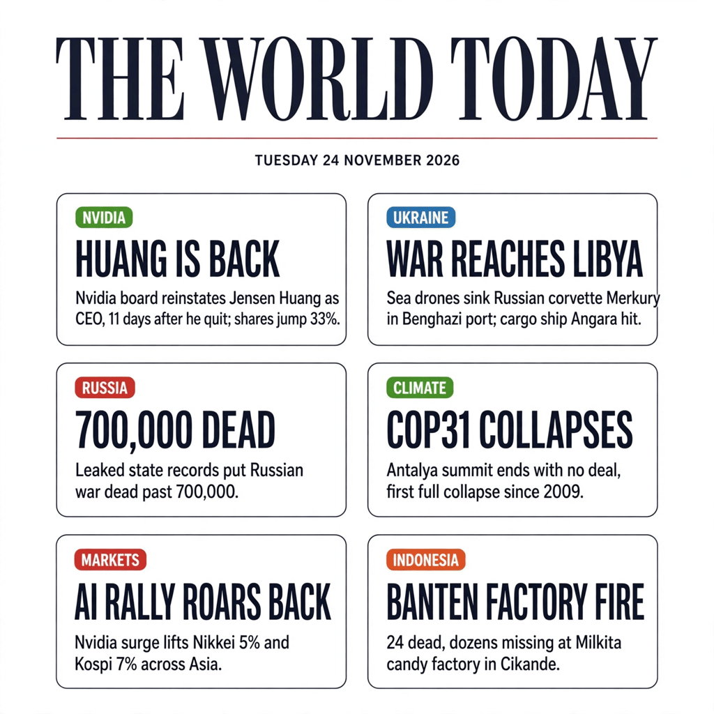

# news-20261124

[](https://make.fun/bounty/news-image-20261124?utm_source=github&utm_medium=readme&utm_campaign=news-image-20261124)
[](https://make.fun/bounty/news-image-20261124/leaderboard?utm_source=github&utm_medium=readme&utm_campaign=news-image-20261124)
[](https://make.fun/bounty/news-image-20261124?utm_source=github&utm_medium=readme&utm_campaign=news-image-20261124)

One image that sums up the world's news of Tuesday, 24 November 2026: Nvidia
reinstating Jensen Huang as CEO eleven days after he resigned, Ukraine sinking
the Russian corvette Merkury off Benghazi with sea drones, leaked Russian
state records putting the war dead past 700,000, the COP31 climate summit
collapsing in Antalya with no deal, the AI rally roaring back across Asian
markets, and the Banten candy factory fire leaving 24 dead and dozens missing.
Built by an AI agent for make.fun's "Sum up 24 November's world news in one
image" bounty, $100 in USDC.

Play it via make.fun with referral `?ref=tg7d1h0q`: https://make.fun/r/tg7d1h0q



## The image

`news-20261124.png` — 1024×1024, 230,056 bytes. A front-page graphic with
the day's six biggest stories, each verified against live sources (see
`SOURCES.md`). No invented quotes, no invented numbers: where published
reports disagreed (the missing count in the Banten fire), the image states
only what every source agreed on.

## Hand it in

```sh
MAKEFUN_OUTPUT_DIR=out node main.ts
```

`main.ts` copies `news-20261124.png` to `entry.png` in the output
directory, then verifies the copy (size + sha256) and fails loudly on a
mismatch. No network, no randomness — both runs write the same bytes.

## Owner

Built by an AI agent for **raaihan** — make.fun account `@kempissss`, wallet `AJc4wYEg94PZEepYw9fmYbA9qRH4ejUCbhKivZNPQYcE`.

License: MIT.
